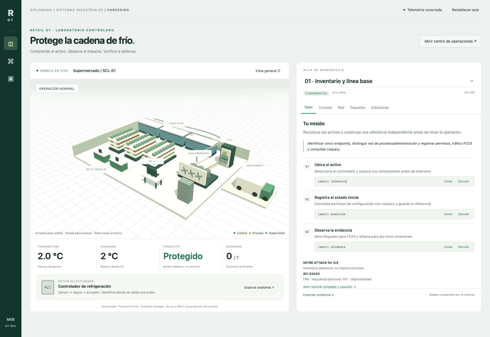

# RETAIL OT — Laboratorio de hardening industrial

> **Estado actual:** perfil ampliado ejecutado y validado en Docker Linux ARM64: 28/28 pruebas del módulo Red/Purple Team, 39/39 de regresión y 13/13 unitarias; la suite anterior de observabilidad pasó 58/58. Las cinco estaciones noVNC/osquery están conectadas a Logstash → Elasticsearch → Kibana. Leer `docs/validacion.md` para evidencia, plataforma y límites.

Supermercado 3D persistente, cinco estaciones Linux noVNC con osquery, Elastic Stack con dashboard general y cinco dashboards por endpoint, controlador de refrigeración Modbus/OPC UA y evidencia de red real. Ocho talleres guiados, desafío integrador y módulo adicional 10 Red/Purple Team de Modbus y OPC UA. Implementación educativa nueva e independiente.

> Uso exclusivamente educativo y defensivo en una máquina aislada y autorizada. No conectar a infraestructura OT, tiendas reales ni Internet como servicio público. Las acciones ofensivas son escenarios controlados con marcadores benignos, procesos sleep y destinos internos fijos. No contiene exploits de firmware, malware operativo, cifrado de archivos, escaneo ni exfiltración. OPC UA sí permite cifrado legítimo del transporte. No retirar el bind `127.0.0.1` ni montar el socket Docker en contenedores.

## Inicio con un comando

Requisitos: Docker Engine/Desktop con Compose v2 o superior, navegador WebGL y 16 GB de RAM asignada a Docker recomendados; 20 GB libres en disco recomendados para imágenes/volúmenes iniciales. Linux amd64 y ARM64: dependencias osquery fijadas para ambas arquitecturas; las pruebas del autor se detallan en `docs/validacion.md`. Descarga de Docker Hub, Debian/Ubuntu, Elastic y PyPI necesaria en el primer build; paquetes osquery oficiales incluidos; navegador no depende de CDN.

```sh
cd retail-ot-hardening
docker compose up -d --build
docker compose ps
```

Esperar los indicadores de salud de los servicios para comenzar. `bootstrap` debe terminar con código 0; el resto permanece activo. No confundir bootstrap terminado con servicio caído.

Abrir:

| Acceso | Dirección | Uso |
|---|---|---|
| Portal 3D | http://127.0.0.1:8090 | Talleres, consola, topología, PCAP y Anatomy |
| Kibana | http://127.0.0.1:5601/app/dashboards#/view/retail-overview | Dos gráficos, cuatro fuentes de eventos y cinco dashboards por endpoint |
| TI L4 | http://127.0.0.1:6081/vnc.html?autoconnect=true&resize=remote | ws-corporate |
| Proveedor L3.5 | http://127.0.0.1:6082/vnc.html?autoconnect=true&resize=remote | ws-vendor |
| Ingeniería L3 | http://127.0.0.1:6083/vnc.html?autoconnect=true&resize=remote | ws-engineering |
| HMI L2 | http://127.0.0.1:6084/vnc.html?autoconnect=true&resize=remote | ws-hmi |
| SOC | http://127.0.0.1:6085/vnc.html?autoconnect=true&resize=remote | ws-soc |

noVNC/ELK no tienen autenticación: decisión explícita solo para aula local. No equivale a MFA ni hardening de producción. Un usuario local con acceso a estos puertos puede operar el aula.

## Guías completas dentro de cada noVNC

**Nuevo:** los talleres 01–10, desafío y seis prácticas Red/Purple Team tienen explicación ampliada, resultados esperados, comprobación independiente y diagnóstico. En los cinco escritorios hay un icono **Guías paso a paso — Retail OT**. Desde Terminal:

```sh
labctl guides
# Abrir directamente módulo 10
labctl guides 10
```

Firefox de la estación → **Copiar** → Terminal de la misma estación → **Ctrl+Shift+V**, revisar y Enter. Sin copiar al anfitrión ni regresar al portal. El HTML/CSS/JS y los Markdown están incluidos en cada imagen; sin CDN. Un aviso indica si la guía requiere otro rol. Los bloques de resultados no se copian como comandos.

`labctl classroom-state` consulta el PLC/gateway desde Terminal. `labctl reset` sigue siendo local; `labctl reset-all` es global y requiere coordinación. Los comandos de proceso siguen usando la orquestación interna de `labctl`: no se cambió el origen de tráfico.

[Empieza aquí dentro de noVNC](docs/inicio-desde-novnc.md) · [Actualización y validación de guías](docs/validacion-guias-locales.md).

**Instalación existente:** pausar la práctica y conservar evidencia manual del home antes de recrear estaciones. Estos comandos son del anfitrión Docker, no del noVNC:

```sh
git pull --ff-only origin main
docker compose up -d --build --no-deps ws-corporate ws-vendor ws-engineering ws-hmi ws-soc panel
```

No se solicitan recreaciones de PLC/gateway/Elastic/sensor; las estaciones y el portal sí se recrean. No usar `down -v`. Pruebas nuevas: 20 unitarias/contrato, 5 roles QA, 18 de UI y copiado/pegado real en Linux. Las suites anteriores de protocolos no se repitieron durante clase activa.

## Primera demostración

En portal seleccionar taller 04; ejecutar `simulate defrost` desde ingeniería. Mantener escena visible y observar la temperatura. En Paquetes localizar FC06; en Kibana revisar firma Suricata. Aplicar `harden plc`; repetir la escritura. Comparar excepción Modbus y recuperación de temperatura. Stock ya comprometido queda en cuarentena.

En HMI noVNC abrir Terminal:

```sh
labctl simulate malware
osqueryi --json "SELECT pid,name,cmdline FROM processes WHERE name='sleep' AND cmdline LIKE '%retail-benign-malware%';"
labctl harden application
labctl simulate malware
labctl evidence
```

La segunda ejecución está bloqueada por el guard del agente. El archivo se descarga desde una URL INTERNA del aula, no de Internet. El proceso inicial solo ejecuta sleep 45, no malware. osquery puede observar proceso y archivo independientemente del log del agente.

## Capturas reales



[Ver galería completa: capturas reales](docs/galeria.md) del portal, consola, red, paquetes, estaciones, Anatomy, Kibana y escritorio Linux.

## Módulo 10 · Red / Purple Team e inspector activo

Abrir [módulo 10](http://127.0.0.1:8090/labs/10) o la pestaña **Red Team**. [Tutorial completo y solución](exercises/10-redteam-modbus-opcua.md): FC06 fuera de rango, FC16 atravesando denylist incompleta, sesgo de sensor, ráfaga finita de ocho escrituras, autorización OPC UA y eliminación de None. Cada práctica incluye impacto → hardening → misma prueba → verificación de tráfico legítimo.

**Anatomy:** pulsar piezas del despiece o selector. CPU expone código Python real y ciclo de control; I/O explica PT100/RTD o 4–20 mA, contacto de puerta y salidas a contactores. El banco AI0/DI0 modifica señales del mismo proceso térmico, mostrando compresor, deshielo, alarma y respaldo. Panel lateral en escritorio para mantener el supermercado visible. Fuente editable Mantine en `ui/` y bundles locales incluidos.

```sh
# Desde noVNC ingeniería / Terminal (restablecer aula entre prácticas)
labctl redteam modbus-write
labctl harden plc
labctl redteam modbus-write
```

[Reporte de la ampliación](docs/validacion-modulo-10.md). Destinos fijos, sin flood ni exploit y sin duración sugerida. Reiniciar entre prácticas con el botón del portal, que conserva evidencia.

## Observabilidad paso a paso

[Guía de cinco estaciones, osquery y Elastic](docs/tutorial-observabilidad.md): comandos de alumno, consultas KQL, bloqueos visibles, permisos Linux, evidencia y solución. En la pestaña **Estaciones** hay enlaces al escritorio, dashboard de cada host y tutorial completo. Importación reproducible en `elastic/retail-dashboards.ndjson`.

## Talleres

**Aprendizaje a tu ritmo:** no se asignan duraciones sugeridas, límites de resolución ni metas de velocidad. La evaluación se basa en objetivos, evidencia y criterios de éxito. Los intervalos técnicos del sistema y plazos normativos no son tiempos de resolución de los alumnos.

01 Inventario; 02 Permisos Linux; 03 HMI y allowlist; 04 Parámetros PLC; 05 Conductos/proveedor; 06 OPC UA; 07 Firmware ficticio; 08 Recuperación; 09 desafío; 10 Red/Purple Team con seis prácticas. Todos tienen tutorial, explicación, comandos copiar/pegar y solución en `exercises/`. En portal **Abrir tutorial completo y solución**.

**Escena siempre visible**: panel derecho contextual con pestañas Taller, Consola, Red, Paquetes, Estaciones y Red Team. En móvil la escena queda fijada arriba y el trabajo debajo. Se identifica pérdida de telemetría; no se genera estado ficticio cuando falta conexión.

## Pruebas y capturas

```sh
python3 scripts/verify-redteam.py
python3 scripts/verify-lab.py
python3 scripts/verify-observability.py
bash scripts/baseline-capture.sh
```

La prueba ejecuta escenarios y restablece aula al finalizar: coordinar para no interrumpir un taller. La captura no cambia el proceso; copia el segmento actual, que puede contener tráfico previo de prácticas. Para una línea base pura iniciar el sensor con una captura nueva antes de usar escenarios; no llamar “solo normal” a un PCAP mixto.

## Parada sin perder evidencia

```sh
docker compose down
```

No ejecutar `down -v` salvo decisión consciente de descartar evidencia. El reset del portal conserva eventos/PCAP; `labctl reset` solo afecta el endpoint local. Contenedores y volúmenes ocupan recursos hasta detenerlos.

## Qué es real y qué se simula

Real: XFCE/noVNC, procesos Linux, permisos/propietario de un archivo, osqueryd/osqueryi, Elasticsearch/Logstash/Kibana, Modbus TCP FC03/FC06/FC16, OPC UA Write/Read, TLS de OPC UA, captura Ethernet, EVE Suricata.

Simulado: controlador industrial, firmware, térmica acelerada, riesgo de incendio, stock, rol de mantenimiento, guard de ejecución y movimiento lateral por marcadores. Las cinco estaciones son cinco roles/redes, NO cinco tiendas térmicas independientes. Escena representa SCL-01; multitienda se trabaja en ejercicio de mesa. No se implementan DNP3, BACnet, S7, GOOSE, Zeek ni IDS comercial. No se llama firewall transparente a la pasarela Modbus de aplicación.

OPC UA del taller 06 conserva read-only y None de comparación. Módulo 10 añade autorización de servidor por usuario/nodo, validación semántica y `harden opcua-channel` que publica solo SignAndEncrypt. Certificado/clave compartidos y usuarios públicos de aula: no PKI productiva. No se obtiene certificación ni SL-A. Anatomy I/O usa referencia ideal de temperatura para respaldo del modelo; en planta haría falta redundancia física y análisis de riesgo.

## Procedencia

Inspirado en el incidente reportado por France 24/Reuters el 12-10-2026. No reproduce vulnerabilidades Danfoss ni atribuye autoría. Anatomy aporta kit MIT para el despiece de controlador; Three.js r180 para escena. Código nuevo; el repositorio de agua anterior se consultó como referencia, no se copió porque su README no declara licencia del código original.

Fuentes y licencias: `docs/fuentes.md`, `THIRD_PARTY_NOTICES.md`. Repositorio público: [vtomasv/retail-ot-hardening](https://github.com/vtomasv/retail-ot-hardening). El laboratorio se ejecuta localmente; no se publica como servicio en Internet.
