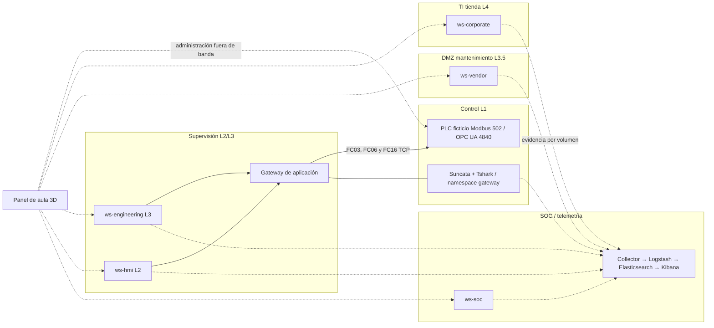

# Arquitectura y límites de Purdue

Redes internas Docker `it`, `dmz`, `supervision`, `control`, `training` y `soc`; `web` permite acceso loopback/noVNC. La red training y el panel son administración pedagógica, no una arquitectura OT de producción. Endpoints no reenvían paquetes como routers. Gateway procesa mensajes Modbus a nivel aplicación y ofrece un túnel TCP fijo 4840 hacia PLC control para captura OPC UA. No es encaminamiento IP transparente.

`ws-hmi` y `ws-engineering` comparten supervisión: etiquetas L2/L3 no constituyen aislamiento entre ellas. `plc` tiene control más training: acceso fuera de banda explícito. Tráfico de proceso capturado en control; no toda la red del anfitrión ni cinco zonas completas. NoVNC utiliza namespace del endpoint; no comparte namespace del host. Sensor comparte namespace gateway, no es IP independiente.

Proceso: registro Modbus 0 consigna entera °C; 1 física ×10 +1000; 2 deshielo; 3 stock comprometido; 4 sesgo sensor ×10 +1000; 5 sensor conectado; 6 compresor; 7 alarma. FC03 lee hasta ocho registros. FC06/FC16 escriben posiciones permitidas; el módulo 10 prueba 0 y 4. Unit ID 1; MBAP precede PDU. Registro 1/2/3/6/7 son telemetría read-only. FC16 valida todas las posiciones antes de mutar. Sin autenticación Modbus clásica.

CPU y térmica viven en `plc/control_logic.py`, fuente real que expone Anatomy. Cada tick toma señal AI0 = física + sesgo (o None si desconectada); aplica histéresis, deshielo y compresor; física converge hacia consigna de deshielo, frío a 2 o ambiente a 18 según actuador. Puerta abierta añade carga. Exposición cuando T>8, stock comprometido desde 12 ticks; riesgo térmico si deshielo y T>35. Umbrales acelerados no sanitarios. Recuperación no revierte cuarentena.

`input_guard` protege calibración remota y usa referencia ideal del simulador si señal falta/diverge; no hay sensor redundante físico en Docker. AI0/DI0 pueden conectarse/desconectarse por API pedagógica Anatomy fuera de banda. DI0 representa puerta; DO0 contactor de compresor, DO1 deshielo, DO2 alarma son estados de software, no potencia eléctrica.

OPC UA 4840, Namespace 2, NodeID strings Setpoint, Temperature, SensorBias, SensorConnected, Compressor. Modo inicial None + SignAndEncrypt, sin permisos finos. Taller 06 `harden opcua` conserva read-only para todos y None de comparación. Módulo 10 `harden opcua-rbac` niega Write de anonymous/observer, permite engineer; servidor valida rango antes de aplicar. `harden opcua-channel` reinicia solo endpoint y publica SignAndEncrypt sin None. Identidades públicas de aula y clave/certificado compartidos: no PKI productiva. La capa de servicios permite Read/Write llegar al guard y no autoriza administración remota de nodos.

Gateway: `redteam fc06-only` activa antipatrón denylist de una función; `harden network` bloquea ambas FC06/FC16; `harden modbus` allowlist de función/dirección/cantidad/valor; `harden write-rate` presupuesto Write separado de Read. Ráfaga de ejercicio fija de ocho operaciones, no DoS. Todas las pruebas se originan en el panel a través de gateway; los cinco roles no equivalen a cinco clientes de protocolo independientes.

Puertos publicados: solo web 8090, Kibana 5601 y noVNC 6081–6085, todos 127.0.0.1. No publicar 502, 4840, 8010, 8001, 8003 ni 9200. Collector lee volúmenes read-only y guarda cursores SQLite; no acceso al socket Docker.
