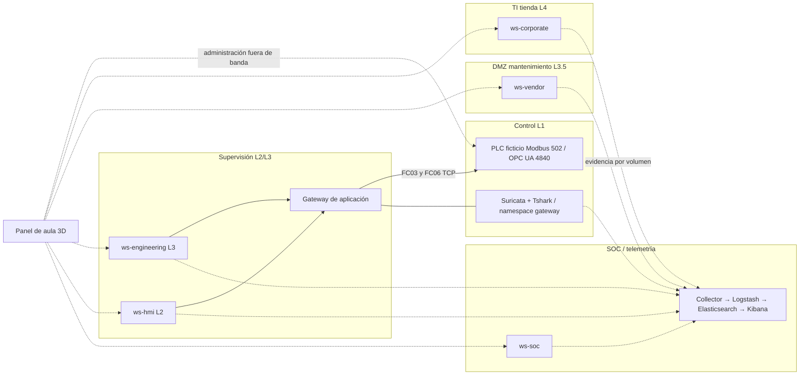

# Arquitectura y límites de Purdue

Redes internas Docker `it`, `dmz`, `supervision`, `control`, `training` y `soc`; `web` permite acceso loopback/noVNC. La red training y el panel son administración pedagógica, no una arquitectura OT de producción. Endpoints no reenvían paquetes como routers. Gateway procesa mensajes Modbus a nivel aplicación y ofrece un túnel TCP fijo 4840 hacia PLC control para captura OPC UA. No es encaminamiento IP transparente.

`ws-hmi` y `ws-engineering` comparten supervisión: etiquetas L2/L3 no constituyen aislamiento entre ellas. `plc` tiene control más training: acceso fuera de banda explícito. Tráfico de proceso capturado en control; no toda la red del anfitrión ni cinco zonas completas. NoVNC utiliza namespace del endpoint; no comparte namespace del host. Sensor comparte namespace gateway, no es IP independiente.

Proceso: registro Modbus 0 consigna entera °C; registro 1 temperatura *10 +1000 (offset didáctico para no usar negativos); registro 2 deshielo; registro 3 stock comprometido. FC03 lee hasta cuatro registros; FC06 escribe solo registro 0. Unit ID 1; MBAP Transaction ID, Protocol ID 0, Length y Unit ID preceden PDU. No autenticación propia Modbus.

Térmica: cada segundo `T <- T + 0.08*(SP - T)`; exposición incrementa cuando T>8, cuarentena desde 12 ticks; riesgo térmico si deshielo y T>35. Son umbrales de enseñanza acelerados, no sanitarios ni de fabricante. Recuperación no revierte stock en cuarentena; reset es operación de aula.

OPC UA: `opc.tcp://plc:4840/retail/`, Namespace 2, NodeID string Setpoint. Inicialmente None y writable. Tras hardening variable read-only para todos y cliente utiliza Basic256Sha256 SignAndEncrypt con certificado fijado; None permanece como endpoint de comparación. Se comparte clave/certificado servidor-cliente únicamente para simplificar aula: no PKI productiva. No se promete autorización por usuario o retiro de endpoint.

Puertos publicados: solo web 8090, Kibana 5601 y noVNC 6081–6085, todos 127.0.0.1. No publicar 502, 4840, 8010, 8001, 8003 ni 9200. Collector lee volúmenes read-only y guarda cursores SQLite; no acceso al socket Docker.
