# Galería del laboratorio Retail OT

Capturas reales de servicios Docker locales, sin imágenes generadas ni datos ficticios añadidos. El material no asigna duraciones de resolución: cada alumno avanza según sus objetivos y evidencia. Las fechas de logs, intervalos de telemetría y ventanas Kibana son parámetros técnicos, no metas de velocidad.

## Escena 3D persistente y objetivos sin duración sugerida.

## Consola acotada: endpoint fijo y comandos de aula.

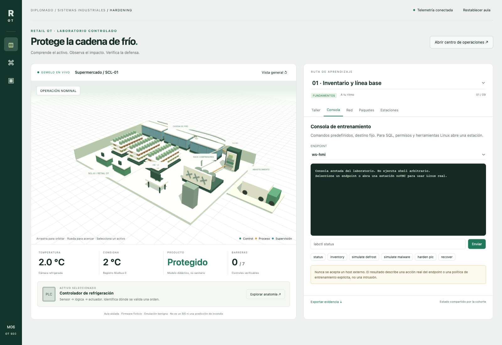

## Topología Purdue: zonas y conductos, red de administración declarada.

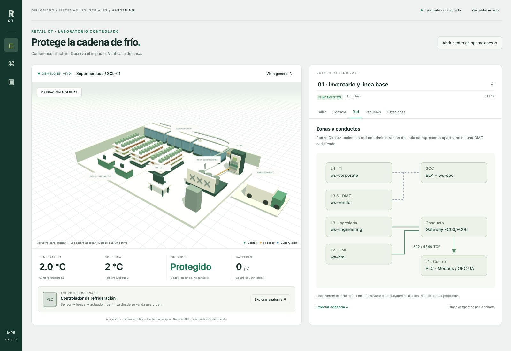

## Payload TCP real capturado por Tshark.

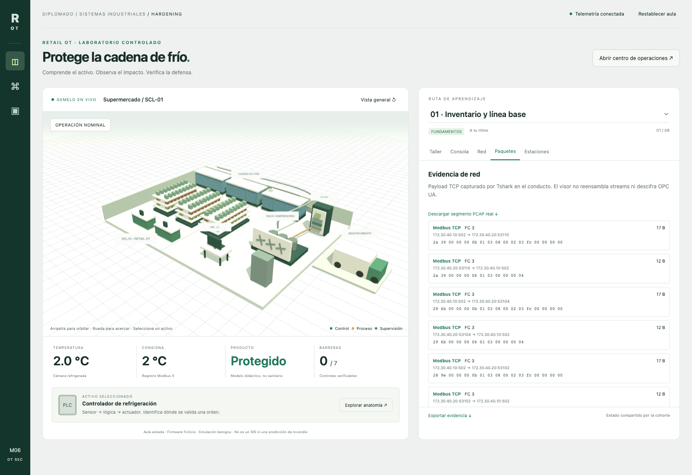

## Cinco estaciones Linux, escritorios noVNC y dashboards por host.

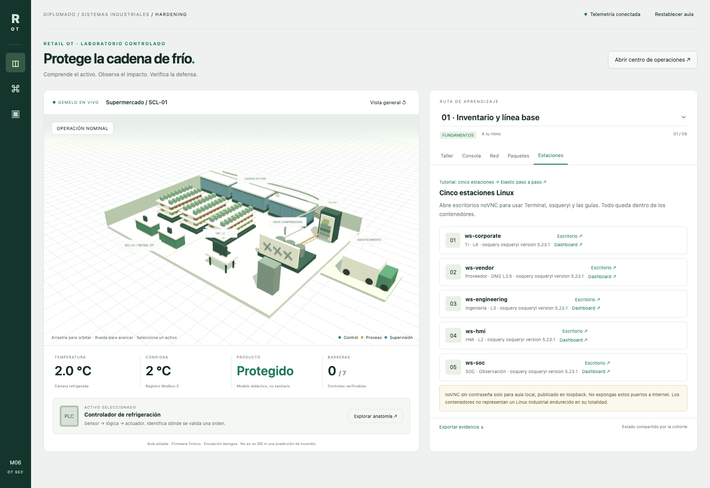

## Despiece Anatomy: componentes de controlador ficticio y contramedidas.

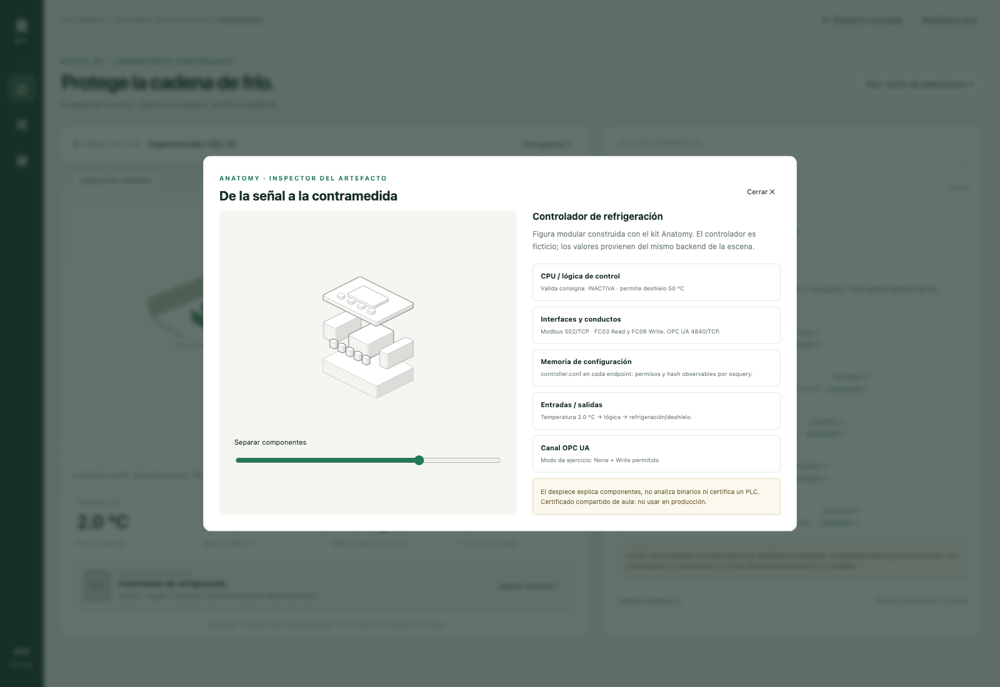

## Kibana: gráficos por activo/fuente y evidencia independiente.

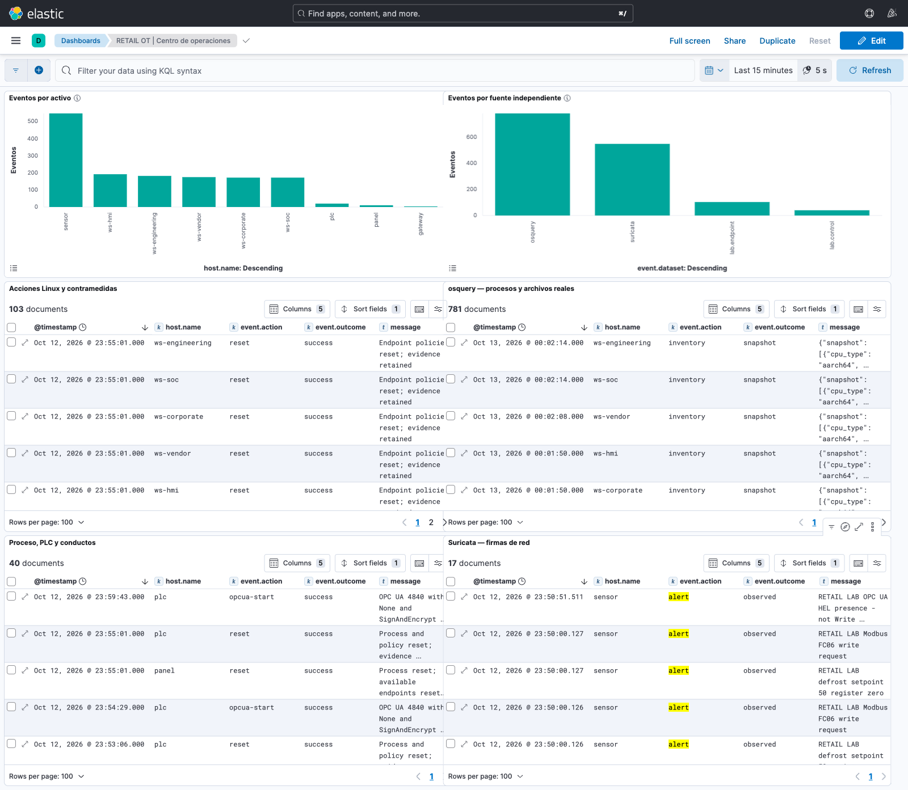

## Dashboard filtrado por HMI: acciones y observaciones osquery reales.

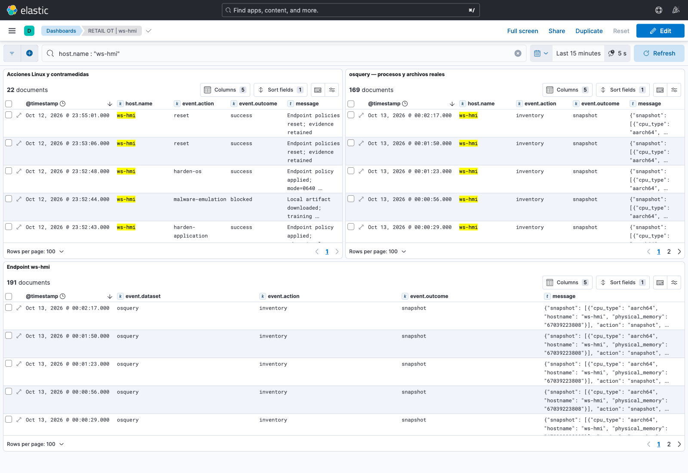

## Escritorio Linux HMI noVNC con terminal de estudiante y osquery real.

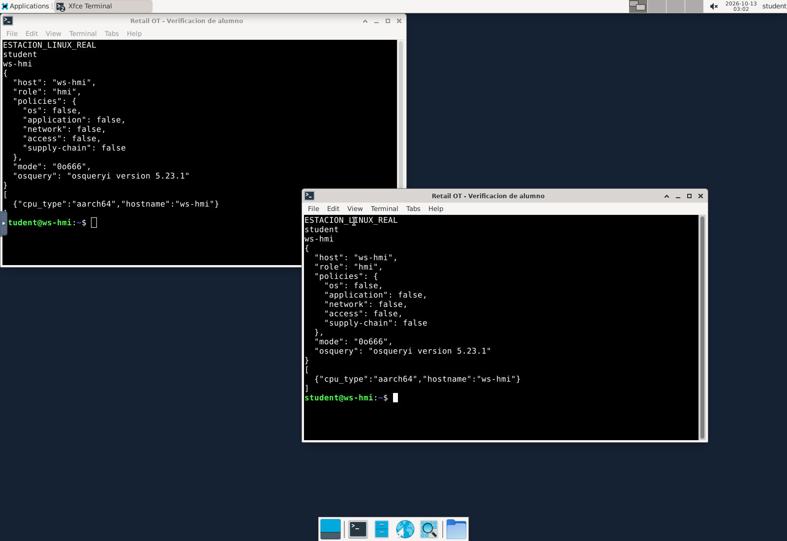

## Módulo 10 · Red / Purple Team y Anatomy activo

### Módulo 10 con seis prácticas, hardening e impacto sobre el mismo gemelo.

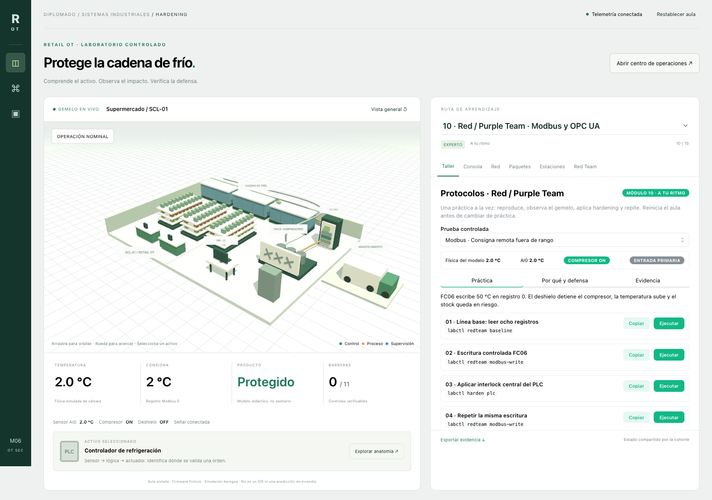

### Código real de CPU y despiece seleccionable con supermercado visible al lado.

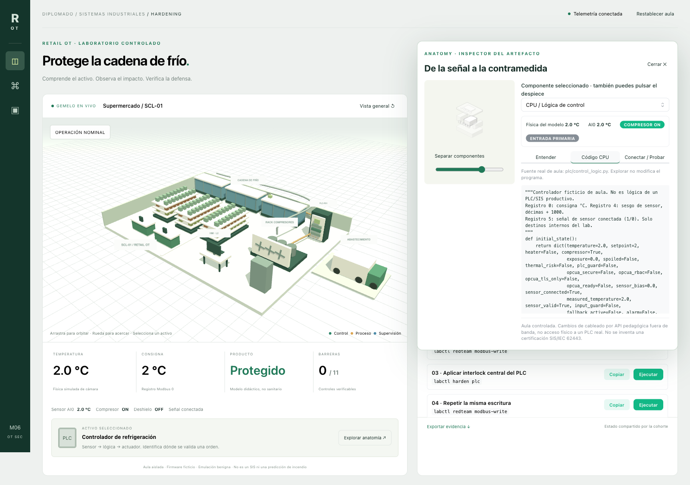

### AI0 desconectada desde inspector: misma señal del PLC y estado del gemelo.

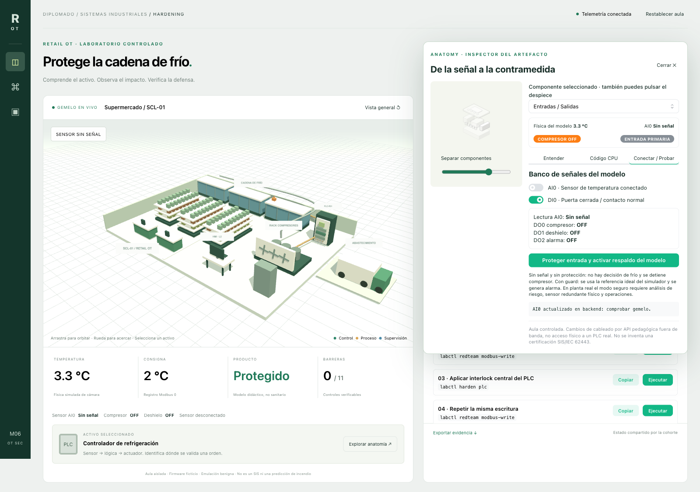

### Hardening de entrada y respaldo ideal del simulador con alarma: no sensor físico redundante.

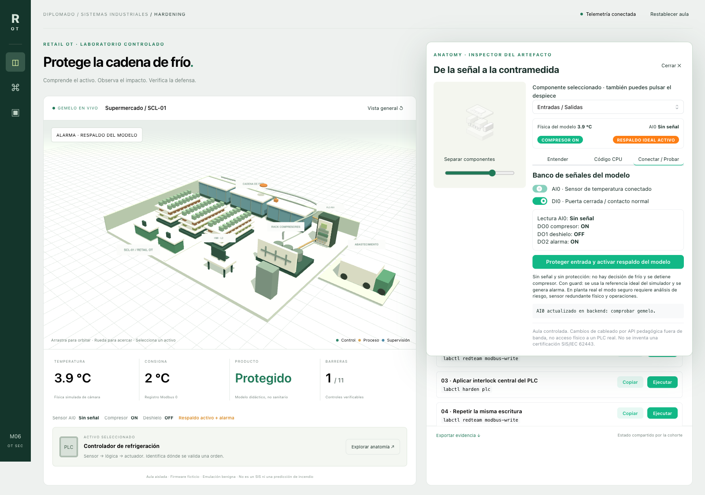

### Lectura de sensor falsa, compresor detenido y señal divergente visible en el gemelo.

## Guías locales noVNC

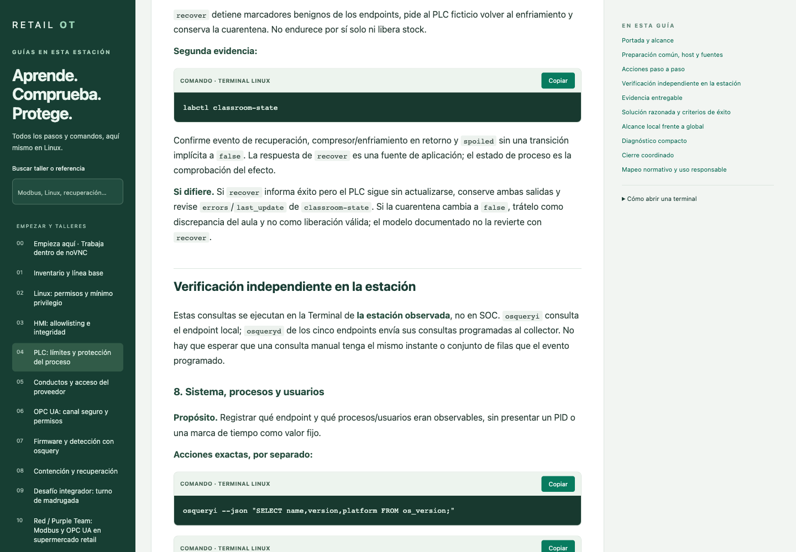

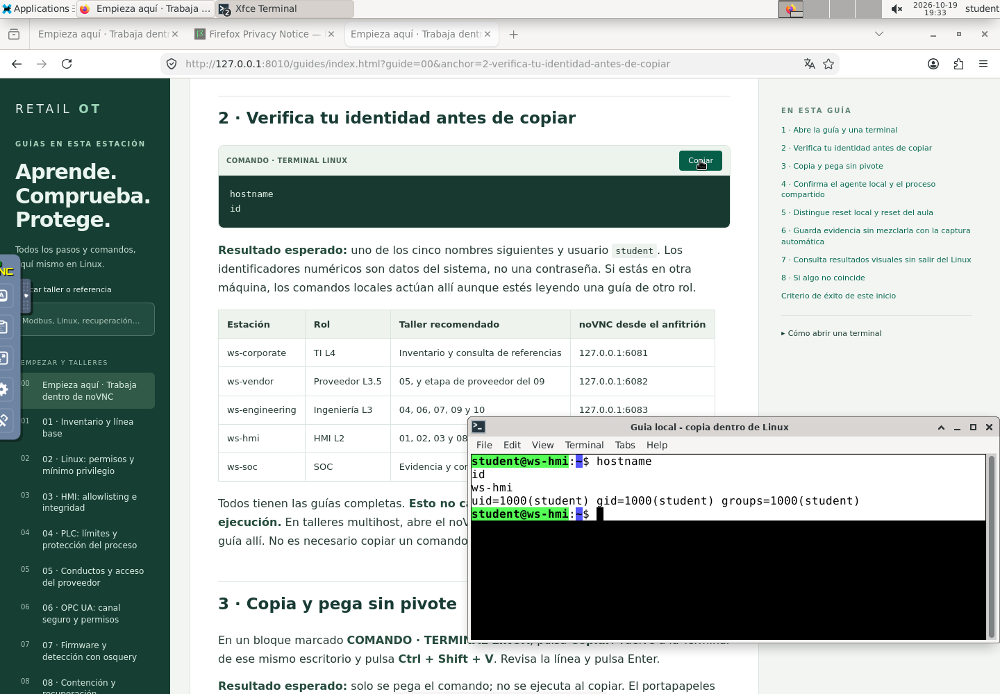

Capturas de las estaciones QA; no se recreó el aula activa para obtenerlas. [Actualización y validación](validacion-guias-locales.md).
